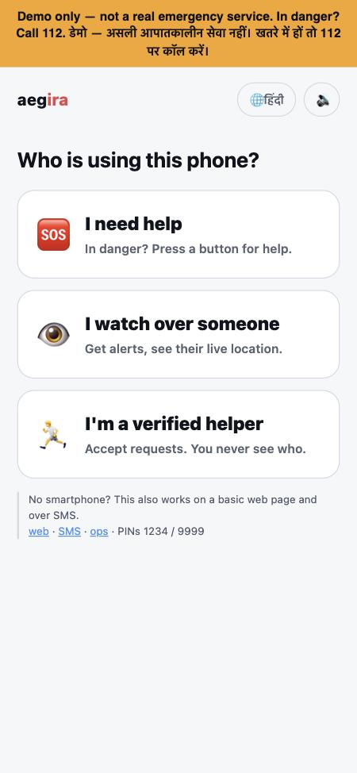
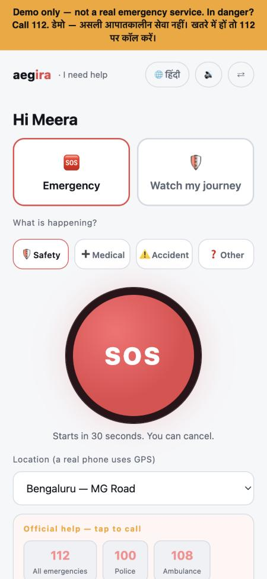
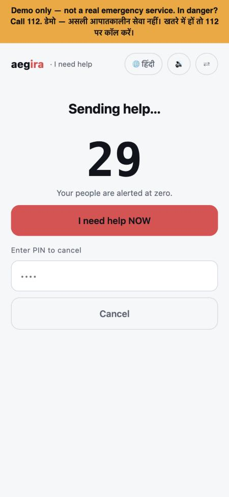
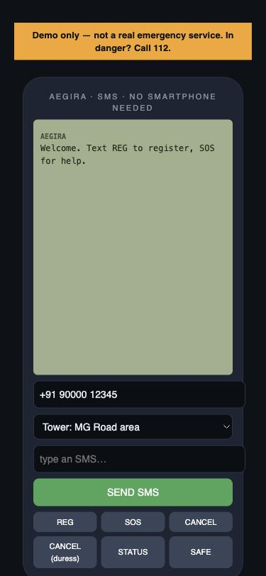

# Aegira — privacy-first emergency coordination

[](https://github.com/heyitsRahul/Aegira/actions/workflows/ci.yml)

**Help on any phone, without becoming a surveillance system.**

Aegira turns an SOS into a consented, time-boxed, *cryptographically mortal*
session. The power to see someone's location or summon a stranger exists only
inside that session, and is destroyed when it ends. It works as a smartphone
app, as a no-JavaScript web page for old browsers, and over plain SMS for
phones with no internet at all.

**Live demo:** [aegira.onrender.com](https://aegira.onrender.com) · **How to use:** [/guide](https://aegira.onrender.com/guide) · **Design doc:** [civic-safety-architecture.md](docs/civic-safety-architecture.md) · **Pitch:** [pitch.md](docs/pitch.md)

> ⚠️ **This is a working prototype, not an emergency service.** No real
> responders are connected yet. Real text messages work once a phone number
> is connected ([how](docs/real-phone-number.md)). In danger, call your local
> emergency number (112 in India and the EU).
>
> The demo runs on a free server that sleeps when unused: the first visit can
> take up to a minute to wake it.

<p>
  
  
  
  
</p>

---

## Try it in two minutes

New here? Open **`/guide`** on the live site: step-by-step instructions for
every kind of phone, in English and Hindi. Or open the live demo (or run it
locally, below) and try this:

1. **Call for help** — open `/app`, pick a language (English or हिंदी), choose
   *I need help*, and press **SOS**. A 30-second countdown starts; enter PIN
   `1234` to cancel it, or let it run.
2. **See the duress PIN lie** — trigger SOS again and "cancel" with PIN `9999`.
   The screen says *cancelled*. Now open `/console`: the server truth shows the
   session is still live and your contacts were told it's a duress alert.
3. **Use it with no smartphone** — open `/phone`, a basic-phone simulator.
   Text `REG Asha 9876543210 1234 9999`, then `SOS near Andheri station`.
   Switch the number to `9876543210` to see the alert your trusted contact
   receives. With a real number connected, the same commands work from any
   real phone.
4. **Try the journey watch** — in the app, choose *Watch my journey*. If you
   don't check in before the timer ends, your contacts are alerted.
5. **Old browser?** `/lite` is the same flow with zero JavaScript.

## What makes it different

| Principle | How it's enforced |
|---|---|
| **No location outside a session** | No table, cache, log or analytics event holds a location without a session id. Tests scan for it. |
| **Deletion you can trust** | Each session has its own AES-256-GCM key. Purging destroys the key (crypto-shredding), so the data is unreadable even in backups. |
| **Duress by design** | A duress PIN returns a response byte-for-byte identical to a real cancel or check-in, while silently escalating. |
| **No cancel after activation** | Once help is in motion there is no "cancel" button an attacker can force you to press. |
| **Responders never see identity** | Before accepting, responders see an alias and a ~1 km area only. Privacy-negative tests assert names, numbers and exact coordinates never appear. |
| **No vigilante feed, no trust scores** | No API lists nearby incidents. Misbehaviour creates reviewable strikes, never a hidden score. Matching is deterministic, no ML. |
| **Works for everyone** | Installable app, zero-JS web, real SMS on any phone; E.164 phone handling and helplines for every country; Hindi + English UI with icon-first screens and spoken prompts. |
| **Honest without a location** | A basic phone's SOS carries no position. Trusted people are still alerted, with the place in the sender's own words, but no stranger is ever sent blind. |
| **No spam from a public demo** | Real alerts reach only numbers that texted `JOIN`, under daily caps; webhooks are signature-checked. |

These are written down as [11 non-negotiable invariants](CLAUDE.md) and
enforced by the test suite in CI.

## Engineering highlights

- **Exhaustive state machine.** 9 session states, 14 event types. Every legal
  transition is asserted and every illegal pair is proven to throw.
- **Hash-chained event log.** Sessions are rebuilt from an append-only,
  hash-chained log; tampering fails verification on reload.
- **Deterministic time.** Countdowns, escalation, auto-close and purge all run
  off an injected clock, so every timer is tested without sleeping.
- **Capability tokens, not accounts.** Help-seeker, contact and responder each
  get a scoped token, stored hashed and compared in constant time.
- **Production lock-down.** In production, secrets have no dev fallbacks, the
  ops console and simulators can be switched off, and a public demo can never
  send real SMS.
- **Resilient notifications.** A failed SMS channel is counted, never allowed
  to stop the emergency or the other channels.
- **394 tests**, typecheck and build in GitHub Actions on every push.
- **Attack and chaos tests:** 300 random runs of every action in any order
  (rules re-checked after every step), and the real server attacked over
  HTTP: 1,000+ malformed inputs, stolen tokens, floods of simultaneous
  requests, code guessing and script injection. See `core/test/chaos.test.ts`
  and `core/test/http-attack.test.ts`.

**Stack:** TypeScript (strict), NestJS, Node 22 built-in SQLite, Vitest,
vanilla JS PWA, Twilio adapter, Docker, Render / Fly.io.

## Architecture

```
core/src/domain/       pure TS, zero framework imports: state machine, session aggregate, phone/geo
core/src/crypto/       per-session envelope encryption + crypto-shred (KMS-shaped interface)
core/src/services/     orchestration, deterministic matching, notifications, SMS gateway, metrics
core/src/persistence/  repository port + SQLite adapter (Postgres-shaped)
core/src/api/          thin NestJS controllers, runtime config
core/public/           landing, PWA, feature-phone simulator, ops console, founder dashboard
core/test/             Vitest: state machine, privacy-negative, hygiene, clock-driven timers, chaos, HTTP attacks
```

## Run it locally

```bash
cd core
npm install
npm test                      # 394 tests
npm run build && npm start    # http://localhost:3000
```

Requires Node 22+. Demo PINs: safe `1234`, duress `9999`.

## Deploy

- **Free public demo:** [render.yaml](render.yaml) — on render.com choose
  *New → Blueprint* and pick this repo. See [docs/publish.md](docs/publish.md).
- **Real phone number:** a spare Android phone + SIM as the SMS gateway. See
  [docs/real-phone-number.md](docs/real-phone-number.md).
- **Durable deployment:** [fly.toml](fly.toml) with a persistent volume. See
  [docs/deploy.md](docs/deploy.md).

| Env var | Effect |
|---|---|
| `AEGIRA_DEMO` | `off` hides the ops console, simulators and dev endpoints (default on) |
| `AEGIRA_ADMIN_TOKEN` | password for `/admin`; in production, unset = dashboard locked |
| `AEGIRA_GATEWAY_SECRET` | secret for the JSON SMS webhook; in production, unset = closed |
| `AEGIRA_BASE_URL` | base URL for contact links (auto-detected on Render) |
| `AEGIRA_DB` | SQLite path (`:memory:` for throwaway) |
| `AEGIRA_SMS_NUMBER` | the number people text, shown in the guide and app |
| `SMSGATE_USERNAME` / `SMSGATE_PASSWORD` / `SMSGATE_SIGNING_KEY` | real SMS through an Android phone ([SMS Gateway for Android](https://sms-gate.app)) |
| `TWILIO_ACCOUNT_SID` / `TWILIO_AUTH_TOKEN` / `TWILIO_FROM_NUMBER` | real SMS through Twilio |

In demo mode, real SMS alerts only reach numbers that texted `JOIN`, at most
100 a day.

## What's real and what's a stand-in

| Real and tested | Stand-in (interface ready to swap) |
|---|---|
| Session lifecycle and state machine | Responder network (two seeded demo responders) |
| Per-session crypto-shredding | KMS (`KeyVault` backed by SQLite) |
| Capability-token auth for 3 roles | Push notifications |
| Real SMS via an Android SIM gateway or Twilio | Postgres (SQLite adapter today) |
| Real GPS in the app, location-less SOS by SMS | Official 112 integration |
| Duress for cancel and journey check-in | |
| Journey watch with timed check-in | |
| Phone numbers and helplines for every country | |
| Restart-safe, chain-verified persistence | |

## License

All rights reserved. The code is public so it can be reviewed; please ask
before reusing it. See [LICENSE](LICENSE).
